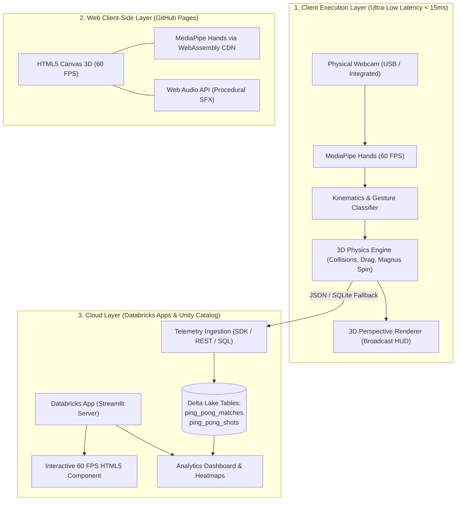

# 🏓 AirPong — AI Table Tennis 3D

[](https://miguelmorandini.github.io/airpong/)
[](https://github.com/miguelmorandini/airpong/actions/workflows/ci.yml)
[](https://python.org)
[](https://www.databricks.com/)
[](https://streamlit.io)
[](https://opencv.org)
[](https://developers.google.com/mediapipe)
[](#automated-testing)
[](LICENSE)

**AirPong** is a 3D table tennis game inspired by the classic **Wii Sports**, powered by real-time webcam hand tracking and computer vision, an intelligent AI opponent (**Roberval**), an advanced ITTF-grade physics engine (aerodynamics, Magnus spin, bounce coefficients), a **Streamlit** telemetry dashboard, and native deployment support for **Databricks Apps** with **Delta Lake** analytical storage.

It also features a **100% client-side Web build** that runs at 60 FPS directly in any modern browser without installing Python or backend dependencies.

---

## 🌟 Key Features

1. **Computer Vision & Gesture Control (MediaPipe Hands & OpenCV)**:
   - Real-time 21-landmark hand tracking at 60 FPS.
   - Depth ($Z$) estimation derived from metric hand scale variation.
   - Vector swing velocity calculation ($\Delta \vec{p} / \Delta t$) with Exponential Moving Average (EMA) and 1€ filter smoothing for jitter-free tracking.
   - Automated stroke classification: **Forehand**, **Backhand**, **Power Smash**, and **Drive**.

2. **3D Physics Engine & Official ITTF Rules**:
   - Official ITTF table dimensions ($2.74\text{ m} \times 1.525\text{ m} \times 0.1525\text{ m}$ net height).
   - Quadratic aerodynamic drag, continuous gravity, and coefficient of restitution ($e = 0.89$).
   - **Magnus Effect (Spin)**: Topspin (diving trajectory), backspin (lift/float), and sidespin (lateral drift).
   - Official scoring rules: 11-point sets, minimum 2-point advantage (deuce), serve alternations every 2 points (or 1 during deuce), and net/table fault detection.

3. **Intelligent AI Opponent (Roberval)**:
   - 4 difficulty levels: **EASY**, **MEDIUM**, **HARD**, and **CHAMPION**.
   - Ballistic prediction of the ball's interception point at the baseline.
   - Stochastic human-like reaction latency and targeting error simulation.

4. **Wii Sports Arcade Feel & Modern Broadcast Visuals**:
   - Realistic 3D perspective projection with dynamic court shadows and depth scaling.
   - Ball speed trail, particle collision sparks, and arcade pop-up alerts ("NICE SHOT!", "SMASH!", "OUT!", "DEUCE!").
   - Sleek television broadcast scorebug with server indicator, speedometer (km/h), and game state overlays.

5. **Databricks Apps Analytics & Telemetry Hub**:
   - Structured persistence in Delta Lake tables (`ping_pong_matches` and `ping_pong_shots`).
   - 2D ball bounce heatmap on the table surface.
   - Interactive Plotly charts for shot type distribution, rally length, and acceleration curves.
   - Resilient local SQLite fallback: works 100% offline without active Databricks credentials.

6. **Dataset Mining & Biomechanical ML Agent**:
   - Automated YouTube mining and synthetic video generator for table tennis strokes.
   - Kinematic feature extraction from 21 hand landmarks and 33 pose landmarks.
   - Integrated Random Forest classifier training, cross-validation, and metrics export.

---

## 🏗️ System Architecture

The project employs a **Hybrid Multi-Target Architecture** designed to overcome cloud network latency and webcam streaming bottlenecks:



### Why this architecture?
Table tennis rallies involve reaction times between 400 ms and 700 ms. Streaming raw video from a browser to a remote cloud container introduces 250 ms to 450 ms of round-trip latency, making gameplay unplayable. Our multi-target model delivers:
- **Local Desktop & Web Canvas**: Sub-15 ms latency with client-side physics and rendering.
- **Databricks Apps**: Centralized tournament hub, deep analytical dashboards, movement training, and embedded 60 FPS playable canvas certified for corporate browsers.

---

## 📁 Repository Structure

```
airpong/
├── .github/
│   └── workflows/
│       ├── ci.yml                 # Automated test pipeline on Python 3.12 (GitHub Actions)
│       └── pages.yml              # Automated GitHub Pages deployment pipeline
├── .dockerignore                  # Docker build exclusions
├── .gitignore                     # Git ignored files (databases, secrets, binaries)
├── Dockerfile                     # Production container image with OpenCV & MediaPipe deps
├── LICENSE                        # MIT License
├── README.md                      # Project documentation
├── app.yaml                       # Databricks Apps deployment specification
├── requirements.txt               # Production Python dependencies
├── requirements-dev.txt           # Testing and development dependencies
├── pyproject.toml                 # Packaging configuration & pytest settings
├── app.py                         # Streamlit application for Databricks Apps & Analytics
├── main.py                        # Standalone native 60 FPS Desktop runner (OpenCV)
├── open_presentation.py           # Helper script to launch the technical slide deck
├── assets/                        # High-resolution logos, arenas, and preview screenshots
├── docs/                          # Client-Side Web Build (GitHub Pages)
│   ├── index.html                 # Entry point, 3D Canvas, and CDN preloading
│   ├── style.css                  # Responsive cyber-stadium theme & glassmorphic layout
│   ├── game.js                    # 60 FPS physics, AI Roberval, Web Audio & Web MediaPipe
│   └── assets/                    # Optimized logos, favicon, and 2K arena texture
├── presentation/                  # Technical & Executive Pitch Deck
│   ├── index.html                 # Interactive slide deck (Wii Sports comparison & metrics)
│   └── open_presentation.bat      # Windows one-click launcher
├── src/
│   ├── config.py                  # ITTF table dimensions, physical constants, parameters
│   ├── engine/
│   │   ├── table.py               # ITTF table geometry, net, and boundary collision checks
│   │   ├── paddle.py              # Virtual paddle kinematics, orientation, and strike zones
│   │   ├── physics.py             # Aerodynamic drag, Magnus spin effect, and ITTF bounces
│   │   ├── ai.py                  # AI opponent (Roberval) with 4 difficulty levels
│   │   └── game_state.py          # State machine, official ITTF scoring, sets, and rallies
│   ├── dataset_agent/
│   │   ├── video_miner.py         # YouTube video downloader & synthetic kinematics generator
│   │   ├── hand_extractor.py      # 21-landmark hand feature extractor via MediaPipe
│   │   ├── dataset_builder.py     # Aggregation, feature augmentation, and export (CSV/Parquet)
│   │   ├── model_trainer.py       # Random Forest stroke classifier training & metrics
│   │   └── agent.py               # Autonomous CLI orchestrator for dataset pipelines
│   ├── vision/
│   │   ├── tracker.py             # Hand & pose tracking with MediaPipe Tasks Vision
│   │   ├── camera.py              # Camera abstraction (Webcam & Synthetic frame source)
│   │   ├── calibration.py         # Step-by-step biometric motion calibration wizard
│   │   ├── gestures.py            # Hybrid ML + heuristic stroke classifier
│   │   └── one_euro_filter.py     # 1€ filter for anti-jitter landmark smoothing
│   ├── databricks/
│   │   ├── client.py              # Databricks SDK workspace client & auth manager
│   │   ├── storage.py             # Unified Delta Lake Unity Catalog storage layer
│   │   ├── mock_storage.py        # Local SQLite storage matching Delta Lake schema
│   │   └── analytics.py           # Heatmap coordinate generation, shot speed, error analytics
│   └── ui/
│       ├── renderer_3d.py         # 3D perspective renderer, scorebug, sparks & popups
│       ├── sound_effects.py       # Procedural audio synthesizer and impact sounds
│       └── components.py          # Streamlit UI theme, KPI metrics cards, and Plotly charts
└── tests/
    ├── test_physics.py            # Ball physics, aerodynamic drag, bounce, and spin tests
    ├── test_game_rules.py         # ITTF scoring rules, deuce, and serve alternation tests
    ├── test_ai.py                 # AI reaction latency and interception trajectory tests
    ├── test_vision_tracker.py     # Computer vision pipeline and synthetic camera tests
    ├── test_storage.py            # Delta Lake and SQLite fallback storage tests
    ├── test_integration.py        # End-to-end game loop integration tests
    ├── test_calibration.py        # Biometric gesture calibration profile tests
    ├── test_one_euro_filter.py    # Anti-jitter filter smoothing and frequency tests
    ├── test_dataset_agent.py      # Dataset agent, feature extractor, and ML training tests
    ├── test_roberval_serve.py     # AI serve flight arc and ball dynamics tests
    ├── test_web_net_and_perf.py   # Web performance, canvas loading, and menu tests
    └── test_web_ui_assets.py      # High-DPI scaling, CSS styling, and asset verification tests
```

---

## 🌐 Play Online in the Browser (GitHub Pages — No Installation)

The Web version of **AirPong** runs **100% client-side** using **HTML5 Canvas 3D**, **Web Audio API**, and **MediaPipe Hands via WebAssembly/CDN**. It requires no backend, Python runtime, or Docker container!

- **Live Demo**: [https://miguelmorandini.github.io/airpong/](https://miguelmorandini.github.io/airpong/)
- **Hand Tracking**: Real-time webcam tracking computed entirely inside your browser with complete privacy (camera feed never leaves your device).
- **Hybrid Controls**: Seamlessly switch between Webcam and Mouse controls in the menu at any time.
- **Procedural Sound**: Audio synthesized in real time via the Web Audio API without heavy external audio files.

### Testing the Web Build Locally:
```bash
# From the repository root:
python -m http.server 8000 --directory docs
```
Open `http://localhost:8000` in Google Chrome, Microsoft Edge, or Firefox.

---

## 🚀 Local Installation & Execution

### 1. Prerequisites
- Python 3.10, 3.11, or 3.12.
- A connected webcam (for computer vision gesture control).

### 2. Setup
```bash
# Clone the repository
git clone https://github.com/miguelmorandini/airpong.git
cd airpong

# Create and activate a virtual environment (recommended)
python -m venv venv

# Windows:
venv\Scripts\activate

# Linux / macOS:
source venv/bin/activate

# Install dependencies
pip install -r requirements.txt
```

### 3. Native Desktop Runner (60 FPS OpenCV Mode)
For the optimal arcade experience with minimum latency:
```bash
python main.py
```

**Controls & Shortcuts:**
- 🖱️ **Mouse Movement**: Move the cursor over the window to steer your paddle with instant, sub-millisecond response.
- 🖱️ **Left Click**: Serve the ball or unleash a *Power Smash* upon impact timing.
- ✋ **Webcam / Hand Tracking**: Automatic detection of 21 hand landmarks and depth scaling.
- 🏓 **Wii Sports Assistance**: $0.50\text{ m}$ magnetic paddle attraction zone for easy returns and satisfying rallies.
- `[SPACE]`: Serve ball
- `[R]`: Restart match
- `[1]`, `[2]`, `[3]`, `[4]`: Switch AI difficulty (Easy, Medium, Hard, Champion)
- `[C]`: Open biometric gesture calibration wizard
- `[S]`: Save match statistics to database
- `[Q]` or `[ESC]`: Quit

### 4. Streamlit Dashboard & Playable Canvas
To launch the interactive dashboard with telemetry and analytics:
```bash
streamlit run app.py
```
Open `http://localhost:8501` in your browser.
- **Interactive 3D Table**: 60 FPS HTML5 Canvas embedded directly into the Streamlit interface.
- **Analytics Hub**: Shot bounce heatmap, stroke type breakdown, and rally speed progression.
- **Dataset Agent Tab**: Inspect ML model metrics, mined kinematics, and trigger one-click re-training.

### 5. Biomechanical Dataset Agent (Video Miner & ML Classifier)
An autonomous sub-agent designed to mine table tennis strokes, extract landmark kinematics, and train machine learning classifiers:
```bash
# Run the full end-to-end pipeline (mine + extract + dataset + train)
python -m src.dataset_agent.agent pipeline --count 1

# Mine specific strokes or generate synthetic biomechanical samples
python -m src.dataset_agent.agent fetch --stroke GANCHO_FOREHAND --count 1

# Build structured dataset from processed video frames
python -m src.dataset_agent.agent build

# Train and evaluate the Random Forest model
python -m src.dataset_agent.agent train
```

---

## ☁️ Deployment

### 1. GitHub Pages
Automated deployment is pre-configured via [`.github/workflows/pages.yml`](.github/workflows/pages.yml).
1. Go to repository **Settings > Pages**.
2. Under **Build and deployment > Source**, select **GitHub Actions** (or **Deploy from a branch** -> branch `main`, folder `/docs`).
3. The site will be live at `https://<username>.github.io/<repo>/`.

### 2. Databricks Apps
The repository includes an [`app.yaml`](app.yaml) manifest configured for native hosting on **Databricks Apps**:
```bash
# 1. Configure workspace credentials
databricks configure

# 2. Create the Databricks App
databricks apps create ai-ping-pong --spec app.yaml

# 3. Synchronize repository files to Workspace
databricks sync . /Workspace/Users/<your-username>/airpong

# 4. Deploy the application
databricks apps deploy ai-ping-pong --source-code-path /Workspace/Users/<your-username>/airpong
```

#### Delta Lake Schema (Unity Catalog):
- **`ping_pong.telemetry.ping_pong_matches`**: Match metadata, final score, winner, longest rally, and average velocity.
- **`ping_pong.telemetry.ping_pong_shots`**: Exact $(X, Z)$ bounce coordinates, stroke classification, speed in km/h, and outcome (`In play`, `Winner`, `Out`, `Net fault`).

### 3. Docker Container
Build and run the containerized application on any cloud or local environment:
```bash
# Build the Docker image
docker build -t airpong:latest .

# Run container on port 8501
docker run -d -p 8501:8501 --name airpong airpong:latest
```
Access at `http://localhost:8501`.

---

## 📽️ Technical Presentation & Pitch Deck

AirPong includes an executive HTML5 slide deck featuring architecture diagrams, latency trade-off matrices, Wii Sports comparisons, and metric evaluations:

```bash
# Open presentation in your default browser
python open_presentation.py
```
Or open [`presentation/index.html`](presentation/index.html) directly in any web browser.

---

<a id="automated-testing"></a>
## 🧪 Automated Testing

The project includes **49 automated tests** covering physics, computer vision, gesture calibration, anti-jitter filters, ITTF regulations, dataset agent pipelines, and web asset integrity:

```bash
# Run full test suite
pytest tests -v
```

Output:
```
============================= test session starts ==============================
collected 49 items

tests/test_physics.py ............                                      [ 24%]
tests/test_game_rules.py ........                                       [ 40%]
tests/test_ai.py .....                                                  [ 51%]
tests/test_vision_tracker.py .......                                    [ 65%]
tests/test_storage.py ..                                                [ 69%]
tests/test_integration.py ...                                           [ 75%]
tests/test_calibration.py ....                                          [ 83%]
tests/test_one_euro_filter.py ...                                       [ 89%]
tests/test_dataset_agent.py .....                                       [100%]

============================== 49 passed in 24.20s ==============================
```

Continuous Integration runs on every commit across Python 3.12 via [`.github/workflows/ci.yml`](.github/workflows/ci.yml).

---

## 📜 License

Distributed under the **MIT License**. See the [LICENSE](LICENSE) file for details.
