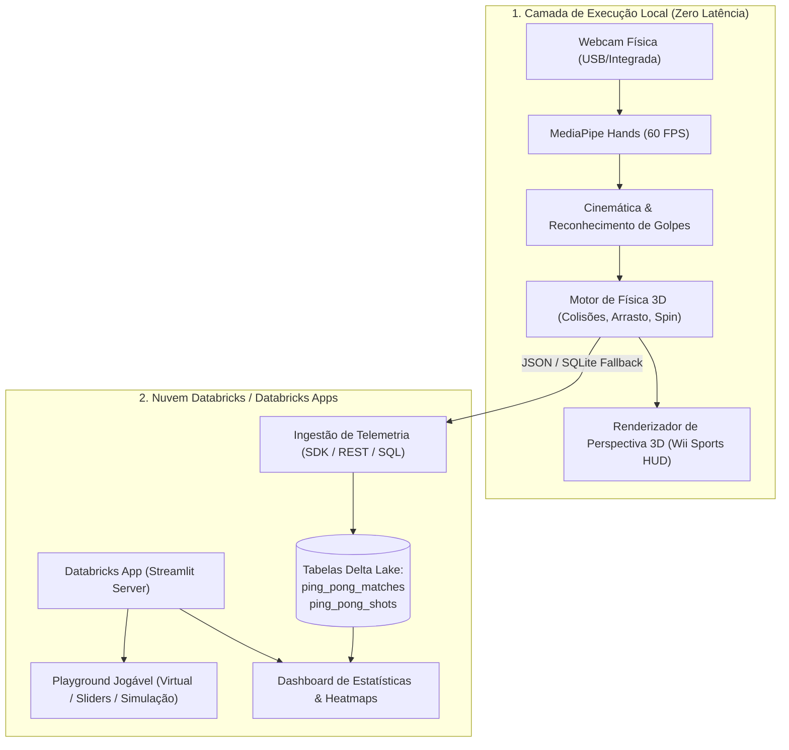

# 🏓 AI Ping Pong

[](https://python.org)
[](https://www.databricks.com/)
[](https://streamlit.io)
[](https://opencv.org)
[](https://developers.google.com/mediapipe)
[](#testes-automatizados)

**AI Ping Pong** é um jogo de tênis de mesa em perspectiva 3D inspirado no clássico **Wii Sports**, controlado em tempo real pelos movimentos da mão capturados pela webcam, com adversário controlado por Inteligência Artificial, motor de física avançado (aerodinâmica, quiques ITTF e efeito Magnus/spin), interface em **Streamlit** e arquitetura pronta para implantação no **Databricks Apps** com persistência analítica em tabelas **Delta Lake**.

---

## 🌟 Principais Funcionalidades

1. **Controle por Visão Computacional (MediaPipe Hands & OpenCV)**:
   - Rastreamento dos 21 landmarks da mão a 60 FPS.
   - Estimativa de profundidade ($Z$) baseada na escala métrica da mão no campo visual.
   - Cálculo vetorial da velocidade do swing ($\Delta \vec{p} / \Delta t$) com suavização exponencial (EMA) para eliminação de ruído.
   - Classificação automática de golpes: **Forehand**, **Backhand**, **Power Smash** e **Drive**.

2. **Motor de Física 3D & Regras Oficiais ITTF**:
   - Geometria oficial da mesa ITTF (2,74 m de comprimento $\times$ 1,525 m de largura $\times$ 0,1525 m de altura de rede).
   - Resistência do ar aerodinâmica (arrasto quadrático) e gravidade contínua.
   - **Efeito Magnus (Spin)**: topspin que faz a bola mergulhar, backspin para sustentação e sidespin para desvios laterais.
   - Regras oficiais: sets de 11 pontos, vantagem mínima de 2 pontos (deuce), alternância de saque a cada 2 pontos (ou 1 ponto no deuce) e detecção de faltas de rede e mesa.

3. **Adversário Inteligente (IA)**:
   - 4 níveis de dificuldade configuráveis: **EASY**, **MEDIUM**, **HARD** e **CHAMPION**.
   - Predição balística de ponto de interceptação na linha de rebatida.
   - Variação estocástica de erro e tempo de reação humano simulado.

4. **Estética Inspirada no Wii Sports**:
   - Projeção de perspectiva 3D realista com iluminação e sombras projetadas.
   - Rastro de velocidade da bola (*speed trail*), faíscas de impacto e feedbacks visuais em pop-up ("NICE SHOT!", "SMASH!", "OUT!", "DEUCE!").
   - Placar estilizado com indicador visual do sacador.

5. **Hub Analítico e Telemetria no Databricks**:
   - Persistência estruturada em tabelas Delta Lake (`ping_pong_matches` e `ping_pong_shots`).
   - Mapa de calor 2D (*Heatmap*) dos pontos de impacto da bola na mesa.
   - Gráficos interativos em Plotly para distribuição de tipos de golpe e curvas de aceleração.
   - Fallback resiliente para SQLite local: funciona 100% mesmo sem credenciais ativas do Databricks.

---

## 🏗️ Arquitetura do Sistema

O projeto adota uma **Arquitetura Híbrida / Multi-Target**, projetada especificamente para contornar as limitações físicas de captura de webcam e latência em contêineres de nuvem:



### Por que esta arquitetura?
Em um jogo com trocas de bola que ocorrem entre 400 ms e 700 ms, o streaming de vídeo do browser para uma nuvem remota gera entre 250 ms e 450 ms de latência total de ida e volta, tornando o jogo lento. Nossa arquitetura oferece:
- **Modo Desktop / Local**: Latência inferior a 15 ms com renderização direta e gravação de telemetria.
- **Modo Databricks Apps**: Hub central de torneios, heatmaps, estatísticas avançadas e modo jogável interativo em nuvem homologado para qualquer navegador corporativo.

---

## 📁 Estrutura do Projeto

```
ping-pong/
├── .github/
│   └── workflows/
│       └── ci.yml               # Pipeline de integração contínua (GitHub Actions)
├── .gitignore                   # Arquivos ignorados pelo Git
├── README.md                    # Documentação do projeto
├── app.yaml                     # Manifesto de implantação no Databricks Apps
├── requirements.txt             # Dependências de produção
├── requirements-dev.txt         # Dependências de teste e desenvolvimento
├── pyproject.toml               # Configuração do pacote Python e pytest
├── app.py                       # Aplicação Streamlit principal para Databricks Apps
├── main.py                      # Runner Desktop autônomo nativo em 60 FPS (OpenCV)
├── src/
│   ├── __init__.py
│   ├── config.py                # Dimensões ITTF, constantes físicas e parâmetros
│   ├── engine/
│   │   ├── __init__.py
│   │   ├── table.py             # Geometria e limites da mesa 3D
│   │   ├── paddle.py            # Cinemática e colisão da raquete virtual
│   │   ├── physics.py           # Arrasto aerodinâmico, efeito Magnus e quiques
│   │   ├── ai.py                # Oponente IA com 4 níveis de dificuldade
│   │   └── game_state.py        # Máquina de estados da partida e pontuação
│   ├── vision/
│   │   ├── __init__.py
│   │   ├── tracker.py           # Rastreamento de mãos via MediaPipe Hands
│   │   ├── camera.py            # Abstrações de câmera (Webcam, Câmera Sintética)
│   │   └── gestures.py          # Classificador de golpes (forehand, smash)
│   ├── databricks/
│   │   ├── __init__.py
│   │   ├── client.py            # Conector de autenticação do Databricks
│   │   ├── storage.py           # Camada unificada para Delta Lake no Unity Catalog
│   │   ├── mock_storage.py      # Armazenamento SQLite com schema idêntico ao Delta
│   │   └── analytics.py         # Cálculos de erros não-forçados e velocidades
│   └── ui/
│       ├── __init__.py
│       ├── renderer_3d.py       # Renderizador de perspectiva 3D estilo Wii Sports
│       ├── sound_effects.py     # Gerenciador de impactos visuais e faíscas
│       └── components.py        # Componentes do Streamlit e gráficos Plotly
└── tests/
    ├── __init__.py
    ├── test_physics.py          # Testes de limites de mesa e colisão
    ├── test_game_rules.py       # Testes de regras ITTF, saque e deuce
    ├── test_ai.py               # Testes de interceptação da IA
    ├── test_vision_tracker.py   # Testes do pipeline de visão e câmera sintética
    ├── test_storage.py          # Testes de persistência Delta/SQLite e analytics
    └── test_integration.py      # Teste de integração de ponta a ponta
```

---

## 🚀 Instalação e Execução Local

### 1. Pré-requisitos
- Python 3.10, 3.11 ou 3.12 instalado.
- Webcam conectada (para controle por visão computacional).

### 2. Instalar Dependências
```bash
# Clonar repositório
git clone https://github.com/seu-usuario/ai-ping-pong.git
cd ai-ping-pong

# Criar e ativar ambiente virtual (opcional, recomendado)
python -m venv venv
# Windows:
venv\Scripts\activate
# Linux/macOS:
source venv/bin/activate

# Instalar dependências
pip install -r requirements.txt
```

### 3. Execução no Desktop (Modo Nativo 60 FPS)
Para a experiência mais fluida com zero latência:
```bash
python main.py
```
**Controles no Teclado:**
- `[ESPAÇO]`: Sacar a bola
- `[R]`: Reiniciar partida
- `[1]`, `[2]`, `[3]`, `[4]`: Mudar dificuldade da IA (Easy, Medium, Hard, Champion)
- `[S]`: Salvar estatísticas da partida
- `[Q]` ou `[ESC]`: Sair

### 4. Execução Web com Streamlit
Para executar o painel web interativo e o hub analítico:
```bash
streamlit run app.py
```
Acesse no navegador: `http://localhost:8501`.

---

## ☁️ Implantação no Databricks Apps

O projeto inclui o manifesto `app.yaml` configurado para execução nativa no **Databricks Apps**:

```yaml
command:
  - "streamlit"
  - "run"
  - "app.py"
  - "--server.port"
  - "8501"
  - "--server.address"
  - "0.0.0.0"
  - "--server.headless"
  - "true"
```

### Passos de Implantação via Databricks CLI:
```bash
# 1. Configurar credenciais do workspace
databricks configure

# 2. Criar a aplicação no Databricks Apps
databricks apps create ai-ping-pong --spec app.yaml

# 3. Fazer o deploy dos arquivos
databricks sync . /Workspace/Users/seu-usuario/ai-ping-pong
databricks apps deploy ai-ping-pong --source-code-path /Workspace/Users/seu-usuario/ai-ping-pong
```

### Schema das Tabelas Delta Lake (Unity Catalog):
- **`ping_pong.telemetry.ping_pong_matches`**: Registra metadados da partida, pontuação final, vencedor, maior rally e velocidade média.
- **`ping_pong.telemetry.ping_pong_shots`**: Registra coordenadas exatas $(X, Z)$ de cada quique, tipo de golpe, velocidade em km/h e desfecho (In play, Winner, Out, Net fault).

---

## 🧪 Testes Automatizados

O projeto conta com **16 testes automatizados** cobrindo todas as camadas críticas (física, visão, regras ITTF, persistência e integração de ponta a ponta):

```bash
# Executar suite completa
pytest tests -v
```

Resultado:
```
tests/test_ai.py::test_ai_difficulties PASSED
tests/test_ai.py::test_ai_predict_interception PASSED
tests/test_ai.py::test_ai_paddle_update_movement PASSED
tests/test_game_rules.py::test_game_initialization PASSED
tests/test_game_rules.py::test_serve_rotation PASSED
tests/test_game_rules.py::test_deuce_and_win_condition PASSED
tests/test_integration.py::test_full_match_simulation_and_rendering PASSED
tests/test_physics.py::test_table_boundaries PASSED
tests/test_physics.py::test_net_collision_detection PASSED
tests/test_physics.py::test_paddle_collision PASSED
tests/test_physics.py::test_ball_bounce_on_table PASSED
tests/test_storage.py::test_save_and_retrieve_match PASSED
tests/test_storage.py::test_analytics_breakdown PASSED
tests/test_vision_tracker.py::test_synthetic_camera_source PASSED
tests/test_vision_tracker.py::test_gesture_classifier PASSED
tests/test_vision_tracker.py::test_hand_tracker_with_frame PASSED

======================== 16 passed in 10.07s ========================
```

---

## 📜 Licença
Distribuído sob licença MIT. Consulte o arquivo de licença para mais detalhes.
